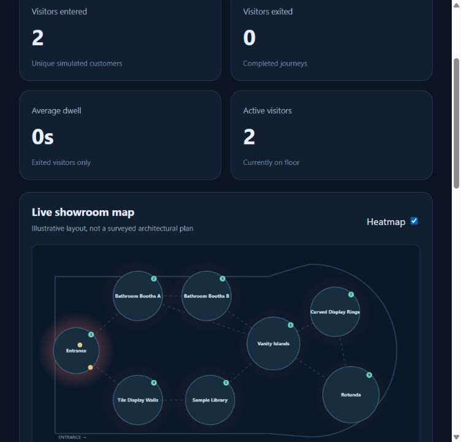

# Showroom Pulse — AI Showroom Analytics Concept Demo

An **open-source, browser-based simulation** of retail showroom movement analytics across eight virtual zones. Inspired by architectural showroom planning and retail space optimization workflows.

> **Scope:** This is a synthetic simulation and visualization demo, **not** an operational AI video analytics or camera-tracking product. It does not accept video, recognize people, assign real salespeople, or provide camera integrations.

[Open the live demo](https://ameer93emad-dev.github.io/ai-showroom-analytics/)

## Try the demo

Switch the simulation to 4× and pause it after several visitors enter. Compare visits with cumulative dwell in the zone panel. The average dwell card uses completed journeys only.

## Features

- Eight conceptual showroom zones with a live illustrative floor map
- Synthetic visitors following connected routes
- Visitor entries, exits, active count, and average completed dwell
- Per-zone unique visit counts and cumulative dwell metrics
- Relative engagement heatmap, activity log, pause/reset, 1×/2×/4× speed
- Export zone metrics as CSV
- Responsive UI with no external dependencies or network calls

## Quick start

Open `index.html` in any modern browser. No installation or build step required.

For local development, you may also run `python -m http.server 8000` and visit `http://localhost:8000`.

## Architecture

- `index.html` — semantic dashboard markup
- `styles.css` — responsive dark interface
- `app.js` — synthetic journey engine, rendering, analytics, CSV export

## Simulation assumptions

The floor plan is **illustrative**, not an accurate rendering of a client project. Each virtual camera icon indicates a conceptual observation zone; no actual cameras are used. Agents randomly visit connected zones and may exit after several stops. Zone dwell is accumulated only while agents are stationary within that zone. Average dwell reflects completed journeys only. All data resets when the page reloads.

## Roadmap

- [ ] Configurable floor plans and zone geometry
- [ ] Deterministic seeded simulation and automated tests
- [ ] Aggregated conversion and staff-assignment *simulations*
- [ ] Accessibility improvements and localization
- [ ] Optional privacy-reviewed adapters for compliant, aggregate real-world inputs

## Privacy and security

This project does not process personal data, video feeds, or biometrics. Never upload real customer footage or confidential client drawings to public issues or repositories. Any future real-world integrations require explicit authorization, privacy-by-design, and compliance review.

## Contributing

Issues and pull requests are welcome. Please keep changes focused, explain the behavior, and avoid including real customer or client data.

## License

MIT — see [LICENSE](LICENSE).
